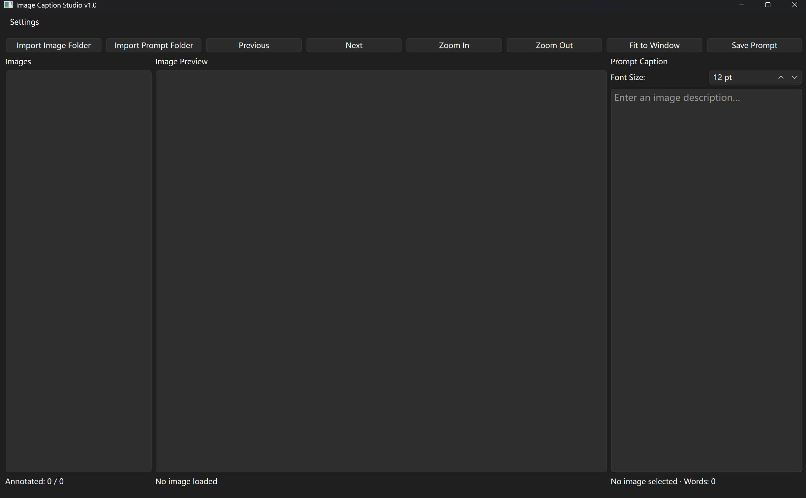

# ImageCaptionStudio

**A Lightweight, Open-Source Image Caption Annotation Tool**

**English** | [简体中文](README_ZH.md)

ImageCaptionStudio is a lightweight desktop application built with Python and PySide6 for manually creating and managing image captions and text prompts.

It is designed for preparing image-text datasets for text-to-image models, LoRA fine-tuning, and other AI training tasks.

## Features

- **Image Management:** Import image folders and browse images easily.
- **Caption Annotation:** Create, edit, and save text descriptions for individual images.
- **TXT Annotation:** Automatically match images with corresponding `.txt` files.
- **Flexible Storage:** Save captions alongside images or in a separate folder.
- **Image Preview:** Zoom in, zoom out, and fit images to the window.
- **Progress Tracking:** Display annotated and unannotated images with progress statistics.
- **Word Counting:** Real-time caption word counting, including Chinese word segmentation.
- **Multilingual Interface:** Switch between English and Simplified Chinese.
- **Customizable Shortcuts:** Configure keyboard shortcuts for common operations.
- **Font Settings:** Adjust interface and caption editor font sizes.

## Screenshot



## Download

Download the latest Windows portable version from [GitHub Releases](../../releases).

Extract the ZIP file and run `ImageCaptionStudio.exe`. No Python installation is required.

## Run from Source

```bash
git clone https://github.com/CVclassmate/ImageCaptionStudio.git
cd ImageCaptionStudio
pip install -r requirements.txt
python main.py
```

## License

This project's original source code is licensed under the [MIT License](LICENSE). Third-party dependencies retain their respective licenses.

Copyright © 2026 Cao Jinhao.
